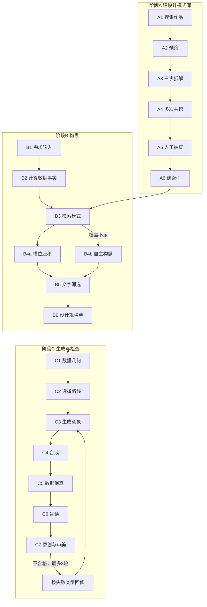

# 基于范例的隐喻图表类比迁移：实验流程与原理

更新日期：2026-11-19。字段 schema 和提示词骨架见 [15-chart-metaphor-transfer-plan.md](15-chart-metaphor-transfer-plan.md)。

## 1. 研究目标与核心假设

**目标**：输入一份真实数据和一句要传达的信息，自动产出一张带视觉隐喻、数据准确、外观原创的图表。

**核心假设**：优秀信息图中可复用的是“图像与数据的组织方式”，而不是画面内容。把组织方式提炼为“固定结构 + 可替换槽位 + 槽位约束”，即可在新主题上重新填充，实现“思路近、外观远”的类比迁移。

**三条设计原则**：

| 原则 | 具体做法 | 解决的问题 |
|---|---|---|
| 只借思路，不借外观 | 构思阶段只提供抽象规则和槽位约束，不提供原图和原作物件词 | 避免抄袭原作 |
| 代码管数据，模型管外观 | 几何、坐标、文字由代码绘制；生图模型只画背景、物件、材质 | 生图模型画不准数值 |
| 生成与评判相互隔离 | 每次生成、读图、评判都使用全新上下文，评判者看不到设计意图 | 避免自评偏差 |

## 2. 角色与贯穿示例

**执行者**：

| 标记 | 含义 |
|---|---|
| `code` | 确定性程序，结果可复现 |
| `LLM` | 只读文字的模型 |
| `VLM` | 实际查看图像的模型 |
| `IMG` | 图像生成模型 |
| `人` | 研究者抽查与确认 |

**贯穿示例**（需求 `b-plastic`）：

- 数据：全球塑料年产量，1950–2019 年，单位百万吨，从 2 增长到 460。
- 信息：七十年间从约 200 万吨增长到约 4.6 亿吨，而且越涨越快。
- 受众与语气：大众，警示；精度要求为“顺序正确”。
- 需要回避的套路：被塑料缠住的海龟、被塑料袋包裹的地球、海洋垃圾漩涡等。

下文中具体意象均为说明用示例，不代表实验结果。

## 3. 总流程

## 4. 阶段A：建设计模式库

目的：把参考作品转化为可检索、可迁移、可追溯的设计模式卡。

| 步骤 | 执行者 | 做什么 | 输出 | 通过标准 |
|---|---|---|---|---|
| A1 搜集 | LLM（联网）+ code | 按检索词和覆盖缺口搜索作品，下载原图并记录出处 | 原图、元数据（链接、作者、说明、许可、哈希） | 合规获取；感知哈希去重；同系列作品归组 |
| A2 预筛 | VLM | 判断是否承载可读数据，图像是否承担含义 | 预筛记录与理由 | 两项都通过才进入拆解；“仅装饰”作品保留为负例 |
| A3 拆解 | VLM，3 个独立上下文 | 按“描述 → 判断 → 抽象”三步填写模式卡 | 3 份独立拆解 | 符合模式卡 schema |
| A4 共识 | code 投票 + LLM 合并 | 策略、图表类型、绑定通道取多数；合并槽位约束并记录分歧 | 设计模式卡、分歧记录 | 关键字段至少 2/3 一致，否则转人工 |
| A5 抽查 | 人 | 对照原图审阅模式卡 | 修改日志 | 试点全查；修改率不高于 30% |
| A6 索引 | code | 建立结构化索引和抽象规则向量 | 模式索引 | 四种策略各不少于 5 张 |

**收集路线**：

1. 人工建立约 10 张种子案例，每张展示“原图 → 拆解 → 可借鉴规则 → 可替换内容 → 迁移示例”，由研究者确认拆解标准。
2. 将确认后的标准写入 A1–A4 的自动流程，扩充至约 30 张。
3. 扩充时以覆盖矩阵为导向，优先补齐缺少的“策略 × 图表类型 × 洞察类型”组合。

**A3 三步拆解**：

1. **只描述**：画面有哪些层，每层是什么、在哪里，数据用什么图形表示。不解释含义。
2. **再判断**：组合策略及理由；每个数据字段绑定到哪个物件的哪个属性；隐喻的源域与映射。
3. **最后抽象**：可替换槽位及约束；一句话抽象规则；反事实检查（把槽位换成中性图形，数据是否还可读、含义是否还在）；与隐喻无关的美学手法。

抽象规则和槽位约束中禁止出现原作物件词与主题词。原作物件词单独存入“表面词”字段，只用于原创检查。

**两类模式分开标记**：

| 类型 | 学习内容 | 示例 |
|---|---|---|
| 表达模式 | 图像与图表的构图、配色、层次 | 场景照片上留白区域放置统计图 |
| 隐喻模式 | 源域对象的某个性质与信息含义的映射 | 物体越高越危险 → 数值越大越严重 |

不要求每张作品都有隐喻，避免把普通的好看设计强行解释成隐喻。

**四种组合策略的判定规则**：

| 策略 | 判定规则 | 可替换内容 |
|---|---|---|
| 叠加 | 移走图表后图像仍然完整 | 背景整体 |
| 并置 | 图像与图表分区摆放，靠语义呼应 | 配图 |
| 替换 | 图表标记被具体物件取代，数值由物件的长度、数量或填充量表达 | 物件外观，编码方式保留 |
| 融合 | 图表几何本身就是物件的一部分 | 物件与材质，几何不变 |

## 5. 阶段B：构思

目的：针对新需求，借用模式库中的思路产出多个候选方案，并在出图前淘汰不可行方案。

### B1 需求输入

由研究者提供：数据文件、要传达的信息、受众、语气、精度要求（精确数值 / 顺序正确 / 仅趋势）、主题领域、需要回避的常见套路、数据来源与处理说明。

### B2 计算数据事实（`code`）

趋势方向、极值、排名、比例、变化率、是否单调、是否加速等全部由代码计算，模型不参与。

- 示例：塑料产量单调上升，且增长逐年加快，洞察类型为“加速上升”，可用图表为折线图或柱状图。
- 这些事实同时作为 C5、C6 检查的标准答案。

### B3 检索模式（`code`）

1. **硬过滤**：洞察类型与图表类型必须兼容；精度要求为“精确数值”时排除只能表达趋势的模式。
2. **领域排除**：排除与当前主题同领域的作品，强制远领域迁移。
3. **语义排序**：按抽象规则向量相似度取前 8 个模式。
4. **覆盖度**：统计满足条件的模式数量，低于阈值时触发 B4b。被排除的模式及原因全部留档。

### B4a 槽位迁移（`LLM`，每个模式一个独立上下文）

- **输入**：抽象规则、槽位约束、数据绑定、美学手法、数据事实、信息。不提供原图和表面词。
- **任务**：为每个槽位提出 3 个新的填充物，逐条说明满足哪条约束、数据绑定如何在新物件上实现、读者第一眼会理解成什么。
- **示例**：模式“让上升趋势成为一个越高越令人不安的物体轮廓” + 塑料产量 → 候选填充物可以是“逐年加高的透明包装盒堆”或“越来越高的合成材料断面”，并说明为什么满足“轮廓连续、高度可映射数值”的约束。

### B4b 自主构思（`LLM`，独立上下文）

- **触发条件**：B3 覆盖度不足，或 B4a 的候选在 B5 中全部被淘汰。
- **方法**：按“组合策略 × 源属性（形状、颜色、数量、动态、空间位置）”逐格构思，不可行的格子写明原因。
- **标记**：结果标注来源为“自主构思”，实验中与迁移结果分开统计。

### B5 文字筛选

| 检查 | 执行者 | 淘汰条件 |
|---|---|---|
| 编码可行性 | code（数据类型 × 视觉通道兼容表） | 通道不兼容，例如用面积表达需要精确比较的数据 |
| 槽位约束 | LLM，独立上下文 | 任一约束不满足 |
| 误读风险 | LLM 扮演普通读者，只看不含设计意图的画面描述 | 理解方向与信息相反 |
| 套路检查 | code + LLM，对照需求中的套路清单 | 命中常见套路 |
| 表面相似 | code，比对来源作品的表面词 | 物件或主题词重合 |

通过的方案两两比较排序，每个需求保留前 3 个。

### B6 设计规格单（`LLM` + `code` 校验）

每个方案落成一份规格单，包含：组合策略、图表类型与字段、载体物件、数据绑定与精度、背景、风格、画幅、标题与标注、关键视觉动作。代码校验 schema、策略与生成路线一致、绑定通道在兼容表内。

## 6. 阶段C：生成与检查

### C1 数据几何（`code`）

根据规格单和数据计算每个数据点的像素坐标，输出图表层与遮罩。通过标准：坐标反算回数值，误差为 0。

### C2 选择生成路线（`code`）

| 路线 | 生图模型画什么 | 代码做什么 | 生成后检查 |
|---|---|---|---|
| 叠加 | 指定区域平静、低细节的场景图 | 在平静区域绘制图表，按背景亮度自动选色 | 数据区繁忙度；对比度不低于 4.5:1 |
| 并置 | 按版面比例生成配图 | 版面布局与图表绘制 | 配图内无文字 |
| 替换 | 单个完整物件，透明或纯色背景 | 抠图，按数值缩放、裁切或重复堆叠 | 物件完整；逐实例可见；无重叠遮挡 |
| 融合 F1 | 一张均匀的材质纹理 | 用数据形状（折线下方面积、扇区、柱轮廓）裁切材质 | 边缘与数据几何完全一致 |
| 融合 F2 | 以数据几何为引导图编辑出物件 | 提取物件边缘与数据折线比对 | 平均偏差超过画面高度 1.5% 时叠加精确细线兜底 |

融合路线优先使用 F1，因为它在保证数据精确的同时能获得物件质感；F2 只用于需要有机变形的情形。

### C3 生成意象（`IMG`）

提示词按优先级拼接，总长度设上限：

1. **主体**：一个核心物件或一个核心视觉动作。
2. **路线约束**：例如叠加写明“画面上半部分是平静的天空，无任何物体”；替换写明“单个完整物件，正面，不裁切”。
3. **风格与配色**：来自规格单和选用的美学手法。
4. **固定禁止项**：不含任何文字、数字、坐标轴、图表元素、标志和水印。

每个方案独立生成 2 张。原始图片不修改、不覆盖，记录实际模型、工具、提示词、时间和文件哈希。

### C4 合成（`code`）

将图像层、图表层和文字层合成两个版本：

| 版本 | 内容 | 用途 |
|---|---|---|
| 评测版 | 图像 + 坐标轴 + 数值标签，无标题与结论句 | 全部自动检查与盲读，防止读者从文字中直接读到结论 |
| 展示版 | 评测版 + 标题 + 数据来源 | 人工评审与展示 |

### C5–C7 检查

| 步骤 | 执行者 | 输入 | 判定 |
|---|---|---|---|
| C5 数据保真 | code + VLM 独立读数 | 评测版、几何记录、数据事实 | 精确数值：相对误差不超过 5%；顺序正确：大小顺序全对；仅趋势：方向与拐点正确 |
| C6 盲读 | VLM，独立上下文，只给评测版 | 回答：画了什么物件、什么图表、什么结论、物件与数据的关系 | 结论方向与信息一致，并能说出载体物件 |
| C7a 原创 | code | 生成图与来源作品及最近邻作品 | 图像向量相似度和表面词重合度低于校准阈值 |
| C7b 审美 | VLM，独立上下文 | 评测版 | 单独打分，只用于排序，不单独淘汰 |

原创阈值由研究者标注 20–30 对“像 / 不像”样例校准。

### 回修规则（`code` 分派）

| 失败类型 | 回修动作 |
|---|---|
| 数据读数错误 | 更换生成路线，或叠加精确细线兜底 |
| 数据区过于繁忙 | 重新生成；仍不达标则加半透明蒙版 |
| 物件身份看不出 | 强化关键视觉动作，简化背景 |
| 结论读反 | 退回 B5，换用其他候选方案 |
| 与原作过于相似 | 更换槽位填充物 |

每个方案最多回修 3 轮，所有轮次的图片与检查结果全部留档。

## 7. 阶段D：对比实验

### 研究问题

- **RQ1**：模式库迁移是否比无库 LLM 构思产出更可读、更新颖、更多样的方案？
- **RQ2**：混合生成是否显著降低数据误差，同时不明显损失美感？
- **RQ3**：生成结果与来源作品是否做到结构相近、外观相异？

### 实验组

| 组 | 构思方式 | 生成方式 | 对比用途 |
|---|---|---|---|
| G0 | 无构思，直接给数据和信息 | 生图模型直出完整图表 | 下限基线 |
| G1 | 无库 LLM 构思（按设计空间提示） | 生图模型直出 | RQ1、RQ2 |
| G2 | 无库 LLM 构思 | 混合生成 | RQ1、RQ2 |
| G3 | 模式库迁移 | 生图模型直出 | RQ1、RQ2 |
| G4 | 模式库迁移（本方案） | 混合生成 | RQ1、RQ2、RQ3 |

- RQ1：比较 G1 与 G3、G2 与 G4。
- RQ2：比较 G1 与 G2、G3 与 G4。
- RQ3：在 G4 内测量与来源作品的结构一致度和外观距离。

### 指标

| 维度 | 指标 | 测量方式 |
|---|---|---|
| 数据 | 读数误差、顺序正确率 | C5 |
| 可读性 | 洞察识别率、隐喻识别率 | C6 |
| 原创 | 与来源作品及最近邻作品的距离 | C7a |
| 多样性 | 同一需求内方案间的平均距离 | 图像向量与文字描述 |
| 审美 | 独立评审分 | C7b |
| 综合 | 人工两两比较胜率 | 研究者盲评展示版 |

### 试点规模

30 张参考作品；8 个需求，覆盖柱状、折线、比例三类图表；每组每需求 3 个方案，每方案 2 张图，共 8 × 5 × 3 × 2 = 240 张。

### 实验规范

1. 正式推理前冻结代码、配置、提示词并记录哈希；冻结后不修改实现、不调整阈值。
2. 每次生成、读图、评判使用独立的全新上下文，只读取分配给它的请求文件。
3. 看图步骤必须实际打开图像；程序占位图不得计入结果。
4. 失败结果、无效输出和所有回修轮次全部保留。
5. 只有一位人工评审时，人工结论标注为单评审初步结果。

## 8. 里程碑与当前进度

| 里程碑 | 内容 | 通过标准 | 状态 |
|---|---|---|---|
| 前期 v4–v6 | 纯代码 SVG 物件编码实验 | — | 已完成：数据与计数基本可控，通用几何图形无法表达物件身份，因此物件外观改由生图模型负责 |
| M-1 | 3 张手写模式卡（叠加、替换、融合 F1）+ 2 个需求（塑料产量、食物排放），从 B2 跑到 C6，共 12 张图 | 代码层数据误差为 0；至少一半盲读正确；研究者认可画面 | 构思与筛选完成（12 份响应）；12 个生图任务已导出；84 项测试通过；等待图像生成入口 |
| M0 | 10 张种子案例人工试拆 | 两次拆解策略一致率不低于 80% | 未开始 |
| M1 | 30 张模式库 | 人工修改率不高于 30% | 未开始 |
| M2 | 叠加、并置、替换三条路线 | 代码层误差为 0；盲读洞察正确率不低于 70% | 未开始 |
| M3 | 融合路线 | 边缘贴合达标率不低于 50%，其余触发兜底 | 未开始 |
| M4 | G0–G4 试点 | 完整报告，失败结果全部保留 | 未开始 |

M-1 的作用是在投入建库之前确认三件事：生图模型能否服从留白、透明背景和无文字要求；混合合成的画面是否可以接受；C5、C6 能否区分好图和坏图。种子案例收集（M0）不依赖图像生成，可与 M-1 并行。

## 9. 相关工作与定位

| 工作 | 已有贡献 | 与本方案的关系 |
|---|---|---|
| Guo et al., CHI 2026 | 隐喻信息图设计空间（目标、源域、重构策略）；LLM 构思 + 文生图方法 | 本方案沿用其策略词表；其方法作为无库基线 G1/G2 |
| Infomages, EuroVis 2020 | 图表嵌入主题照片 | 叠加与融合式嵌入已有先例 |
| ChartSpark, TVCG 2023 | 文生图生成图表语义背景 | “图表 + 生成背景”已有先例 |
| MetaGlyph, TVCG 2022 | 自动生成隐喻字形 | 隐喻字形已有先例 |

本方案主张的差异：

1. **基于范例的槽位级迁移**：从真实作品中提取固定结构、可替换槽位和约束，再按数据洞察检索迁移。
2. **数据保真**：代码负责几何，融合路线也能通过遮罩裁切保证数值精确。
3. **自动检查与回修闭环**：数据、可读性、原创性逐项检查，失败按类型回修，全程留档。

以上差异均需由 G0–G4 实验结果支持。
